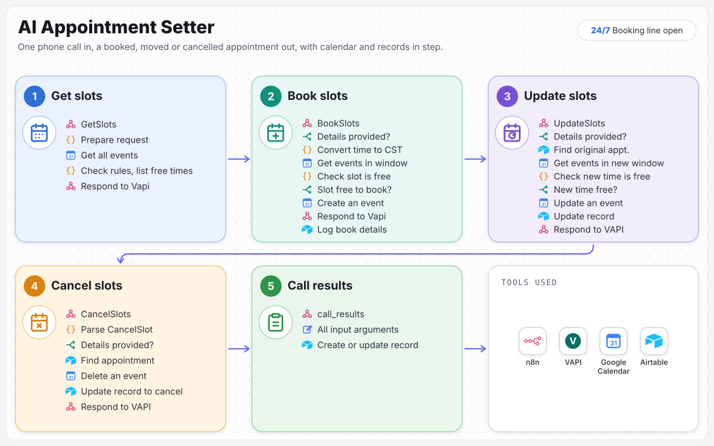

# AI Appointment Setter

Callers book, move or cancel appointments at any hour, without waiting for a person.

An AI voice agent that answers calls, checks the calendar, and books, moves or cancels appointments while the caller is still on the line, keeping Google Calendar and Airtable in step. Built with VAPI and n8n.

**Full case study:** [ramonvallejera.com/case-study/ai-appointment-setter](https://ramonvallejera.com/case-study/ai-appointment-setter)

## How it works

1. Caller asks for a time
2. Agent checks Google Calendar
3. Offers free times
4. Books, moves or cancels the event
5. Confirms on the call
6. Call result saved in Airtable

Built five n8n flows that a VAPI voice agent calls during the conversation: one checks free times in Google Calendar, one checks the slot is still free, books it and logs it in Airtable, one finds an existing appointment and moves it once the new time is confirmed free, one finds and cancels it, and one saves the result of every call.

## What's in this repo

| File | What it is |
|---|---|
| `workflow.json` | The n8n workflow, 55 nodes, ready to import |
| `docs/process-map.svg` | The process map from the case study |

Triggers: the webhooks `GetSlots`, `BookSlots`, `UpdateSlots`, `CancelSlots` and `call_results`, one per VAPI tool.

Booking rules: `BookSlots` and `UpdateSlots` read the calendar again right before writing, and only go ahead if the time is a weekday, 9:00 AM to 6:00 PM Central, in the future and clear of other events. Otherwise nothing is booked or moved and VAPI gets the reason to tell the caller. Change the hours in the `Check Slot Is Free`, `Check New Time Is Free` and `Available Start Time and Date Ranges` code nodes.

## Set it up

1. In n8n, open **Workflows → Import from File** and choose `workflow.json`.
2. Create these credentials and select them on the nodes that need them:

   - Airtable (personal access token) (6 nodes)
   - Google Calendar (OAuth2) (6 nodes)

3. Replace the placeholders with your own records:

   - `YOUR_AIRTABLE_BASE_ID` (6×)
   - `YOUR_AIRTABLE_TABLE_ID` (6×): each node keeps the original table name as a hint
   - `YOUR_CALENDAR_ID` (6×)
   - `you@example.com` (6×): your calendar or sending address

4. Run it once with test data, then activate it.

Tools: n8n, VAPI, Google Calendar, Airtable.

## Notes

- Credentials, webhook IDs, pinned test data and account-specific IDs were removed before publishing. n8n assigns new webhook URLs on import.
- Built by Ramon Vallejera Jr., AI Automation Specialist.
